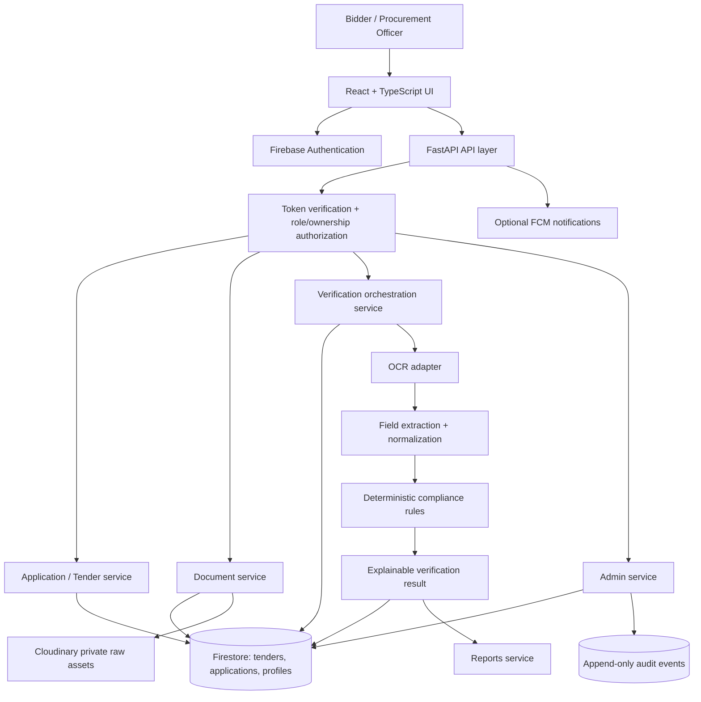

# NIRNAY architecture and implementation flow

## Current implementation vs target diagram

The supplied diagram describes a larger procurement application with tender creation, bidder applications, document intelligence, OCR, field extraction, deterministic compliance rules, verification orchestration, reports, and an audit trail.

The current repository is an earlier-stage implementation. It has a React + TypeScript + Vite frontend, a FastAPI backend, Firebase Authentication, Firestore user records/document metadata, Cloudinary raw-file storage, optional Firebase Cloud Messaging, and a demo tender endpoint. The OCR, field extraction, registry integration, compliance orchestration, and persisted tender/application workflows shown in the diagram are not yet implemented as a connected production workflow. Do not represent them as completed features until implemented and tested.

## Recommended target architecture

## Request and processing flow

1. **Identity:** the browser signs in with Firebase Authentication and sends a Firebase ID token as a bearer token.
2. **Authorization:** FastAPI verifies the token and revocation status. Every endpoint checks ownership or a trusted custom-claim role. Frontend route guards are only UX; they are not security controls.
3. **Tender management:** validated tender definitions are persisted in Firestore. The current `GET /api/v1/tenders/demo` endpoint is demo data, not a tender-management backend.
4. **Application intake:** an authenticated bidder creates an application linked to a real tender. The server owns application status transitions and timestamps.
5. **Document intake:** the API validates size, file signature/type, filename, and ownership. It stores file bytes in Cloudinary and metadata in Firestore. A failure between those writes must be observable and reconciled.
6. **Document intelligence:** a background job processes an accepted document using an OCR adapter, normalizes extracted fields, and stores structured evidence plus confidence/provenance. The current repo does not yet implement this pipeline.
7. **Compliance evaluation:** deterministic rules evaluate evidence against tender requirements. AI/OCR output is evidence, not the final authority. Results include pass/fail/needs-review, evidence references, rule version, reasons, and confidence where justified.
8. **Human review:** ambiguous or high-impact results are queued for a reviewer. Reviewers record decisions and rationale.
9. **Reporting and audit:** reports are generated from persisted applications and versioned verification results. Privileged actions and status changes emit audit events.
10. **Administration:** trusted Firebase custom claims gate user-role management and operational views. Role changes are audited and never accepted from client-supplied profile fields.

## Suggested Firestore collections

- `users/{uid}`: non-authoritative profile fields only; role authority is Firebase Auth custom claims.
- `tenders/{tenderId}`: tender identity, issuer, deadline, status, requirements, version, timestamps.
- `applications/{applicationId}`: tenderId, bidderUid/organizationId, status, submittedAt, version.
- `applications/{applicationId}/documents/{documentId}`: owner, original filename, detected MIME, size, Cloudinary public ID, hash, processing status, timestamps.
- `verificationRuns/{runId}`: applicationId, rule-set version, pipeline version, status, started/completed timestamps.
- `verificationRuns/{runId}/findings/{findingId}`: requirement ID, outcome, evidence references, explanation, confidence/provenance.
- `admin_audit_logs/{eventId}`: actor UID, action, target, timestamp, request/correlation ID, minimal redacted details.
- `jobs/{jobId}` (only if a durable worker queue is added): idempotency key, status, attempts, next retry, error category.

Use Firestore indexes and pagination for list endpoints. Avoid storing entire file contents or secrets in Firestore. Keep a schema/version field on long-lived tender and verification records.

## Implementation order

### Phase 1 — Make the current application reliable
- Fix and test document downloads; surface a safe request ID and useful error detail in local logs.
- Add API integration tests for auth, record ownership, document upload/download/delete, and storage failures.
- Correct the README so it describes Cloudinary storage consistently rather than claiming Firebase Storage is required.
- Add frontend/backend CI checks and pin a reproducible dependency set.
- Add request size/time limits and file-signature validation.

### Phase 2 — Build real tender and application data
- Define Pydantic request/response schemas and Firestore repositories.
- Implement admin-only tender create/update/publish/archive endpoints.
- Implement bidder application create/save/submit and server-controlled status transitions.
- Add reviewer role and application-scoped authorization.

### Phase 3 — Document intelligence and compliance
- Define a provider-neutral OCR interface; start with a synchronous local adapter for development.
- Move OCR/extraction to a durable background queue when latency/retries require it.
- Store extracted fields with page/coordinate evidence, confidence, and source document hash.
- Implement versioned deterministic rules and an explicit needs-human-review state.
- Add synthetic test corpus and regression fixtures; never treat model confidence alone as proof of compliance.

### Phase 4 — Reports, audit, and admin operations
- Persist report generation status and report references.
- Add append-only audit events for role changes, tender changes, application submission, reviewer decisions, and document actions.
- Add admin views for users, tenders, applications, failed processing jobs, and audit history.

## Download failure diagnostic

The current download path is `GET /api/v1/documents/{document_id}/download`. It looks up metadata under the authenticated user's UID, creates a Cloudinary signed URL, then fetches the file server-side. Failures may be a 401/403 authentication problem, 404/409 missing or legacy metadata, or 502 Cloudinary URL/delivery failure. Check the browser Network tab for this endpoint's status and the response's `detail` message; do not expose API secrets or signed URLs in shared logs.

A successful UI click is not enough: verify that the response is HTTP 200, the returned byte size matches the stored `size_bytes`, and the downloaded file opens. If the API returns 502, inspect the backend terminal for the underlying Cloudinary response while keeping credentials and signatures redacted.
